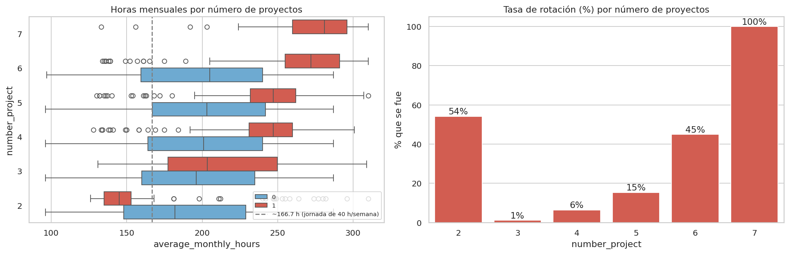
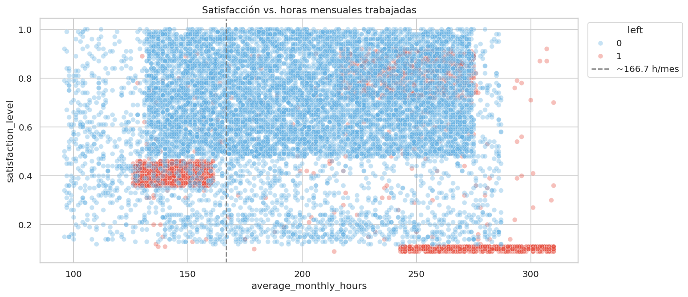
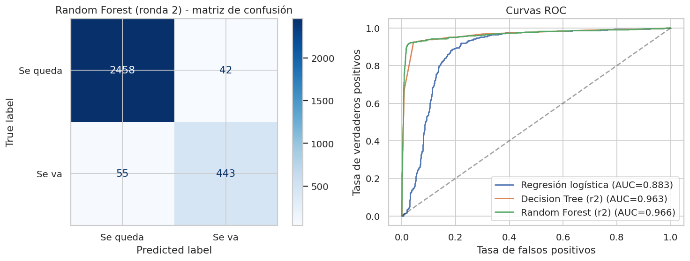
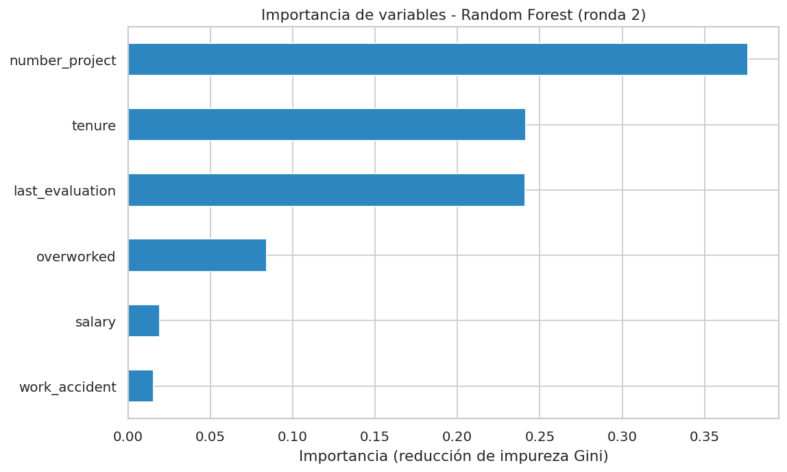

# 👥 Salifort Motors: Predicción de rotación de empleados

**Proyecto final (Capstone) del Google Advanced Data Analytics Certificate**
Autor: **Abraham García** · Ingeniero Industrial · Lean Six Sigma Green Belt · Google Data Analytics

> **Resumen en una línea:** analicé una encuesta de RR. HH. de 15,000 empleados y construí un modelo de Random Forest que **predice quién dejará la empresa con 91 % de precisión y 89 % de recall (AUC 0.97)**, e identifiqué que la rotación se debe sobre todo a **sobrecarga de proyectos, antigüedad de 3–5 años y falta de ascensos**, no al departamento.

---

## 🎯 El problema de negocio
Salifort Motors tiene una rotación alta de empleados y reemplazarlos es muy costoso (reclutamiento, capacitación, desarrollo). La dirección pidió:
1. Entender **qué factores impulsan** la salida de empleados.
2. Construir un modelo que **prediga** si un empleado se irá.
3. Recomendar **acciones** para mejorar la retención.

## 🧭 Metodología: marco PACE
| Fase | Qué hice |
|---|---|
| **Plan** | Definí partes interesadas, objetivo, diccionario de datos y consideraciones éticas |
| **Analyze** | Limpieza (renombrar columnas, 3,008 duplicados, outliers por IQR) y EDA con 7 visualizaciones |
| **Construct** | Regresión logística, Árbol de decisión y Random Forest con GridSearchCV y validación cruzada |
| **Execute** | Interpreté resultados, importancia de variables y redacté recomendaciones para la dirección |

## 🔍 Hallazgos principales
- **Sobrecarga:** con 6 proyectos se va el 45 % y con 7 proyectos se fue el **100 %**. El rango saludable es 3–4 proyectos (1–6 % de rotación).
- **Bajo compromiso:** con solo 2 proyectos se va el 54 %.
- **Antigüedad:** la rotación se dispara a los **5 años (45 %)**; casi no hay salidas en el año 2 ni después del año 6.
- **Talento de alto desempeño en riesgo:** evaluación alta + más de 240 h/mes → 47 % de rotación.
- **Salario y ascensos:** rotación de 20.5 % con salario bajo vs. 4.8 % con salario alto; solo 1.7 % de empleados fue ascendido en 5 años.
- **El departamento casi no influye** (de 11.9 % a 18.8 %).




## 🤖 Modelos y resultados
Evaluados en un conjunto de prueba (25 %) que nunca se usó para entrenar:

| Modelo | Precisión | Recall | F1 | Accuracy | AUC |
|---|---|---|---|---|---|
| Regresión logística | 0.441 | 0.261 | 0.328 | 0.819 | 0.883 |
| Árbol de decisión (ronda 2) | 0.809 | 0.926 | 0.863 | 0.951 | 0.963 |
| **Random Forest (ronda 2) ✅** | **0.913** | **0.890** | **0.901** | **0.968** | **0.966** |

> **Detalle importante:** en la ronda 1 los modelos daban resultados casi perfectos (AUC 0.98). Lo traté como señal de **posible fuga de datos** (`satisfaction_level` no estaría disponible al momento de predecir), así que en la ronda 2 la eliminé y creé la variable `overworked` (>175 h/mes). El modelo final sigue siendo muy bueno y es más realista.




## ✅ Recomendaciones para la dirección
1. Limitar el número de proyectos por persona (máximo 5).
2. Reconocer o compensar las horas extra, o dejar de esperarlas.
3. Programas de desarrollo y conversaciones de carrera antes del año 4.
4. Política de ascensos clara y más frecuente.
5. Revisar carga y compensación del talento de alto desempeño.
6. Usar el modelo como **alerta temprana** para intervenir, **nunca para sancionar**.

## 📂 Estructura del repositorio
```
├── README.md
├── requirements.txt
├── data/
│   └── HR_capstone_dataset.csv
├── notebooks/
│   └── Salifort_Motors_Capstone_Rotacion_Empleados.ipynb
├── images/                      # Gráficas del análisis
└── docs/
    └── Resumen_Ejecutivo_Salifort.pptx
```

## ▶️ Cómo reproducirlo
```bash
git clone https://github.com/<tu-usuario>/<nombre-del-repo>.git
cd <nombre-del-repo>
pip install -r requirements.txt
jupyter notebook notebooks/Salifort_Motors_Capstone_Rotacion_Empleados.ipynb
```

## ⚠️ Limitaciones
Datos de encuesta (posible sesgo), 20 % de filas duplicadas eliminadas, correlación no implica causalidad, no se distingue entre renuncia y despido, y el dataset parece tener patrones sintéticos. No incluí XGBoost (opcional en la actividad) para que el proyecto se reproduzca solo con scikit-learn.

## 🛠️ Herramientas
Python · pandas · NumPy · matplotlib · seaborn · scikit-learn · Jupyter

## 📬 Contacto
**Abraham García** · Reynosa, Tamaulipas, México · www.linkedin.com/in/abrahamgarcia-ing · abrahamgarcia.ingindus@gmail.com

*Dataset: [HR Analytics and Job Prediction (Kaggle)](https://www.kaggle.com/datasets/mfaisalqureshi/hr-analytics-and-job-prediction). Proyecto con fines educativos.*
